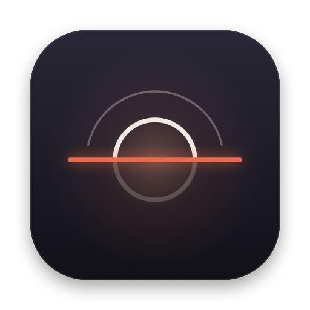
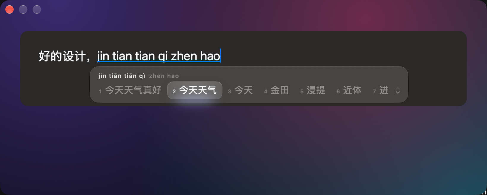
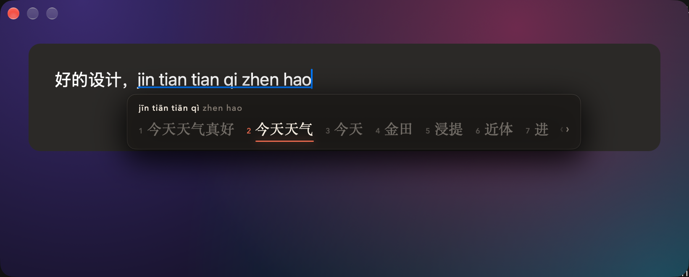
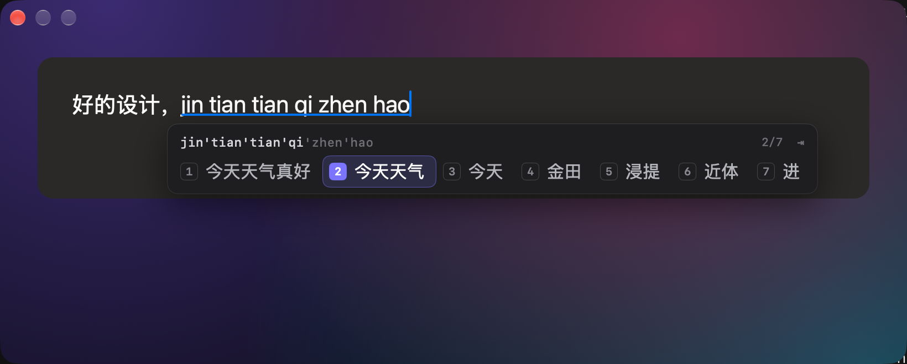
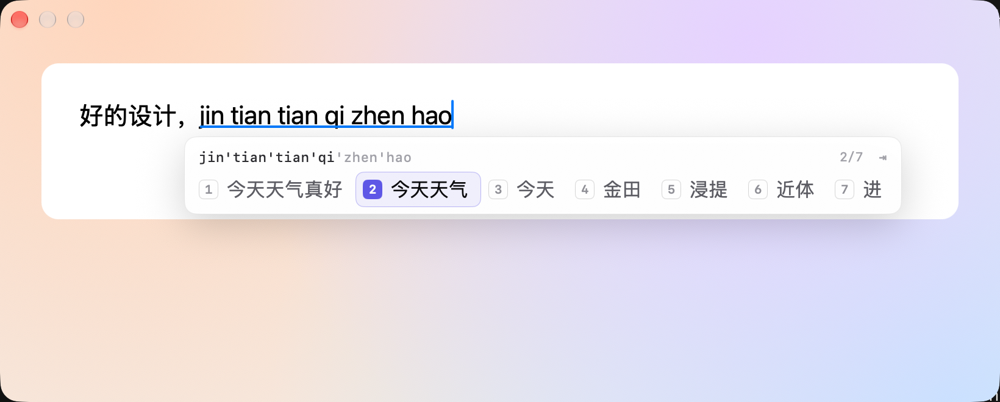
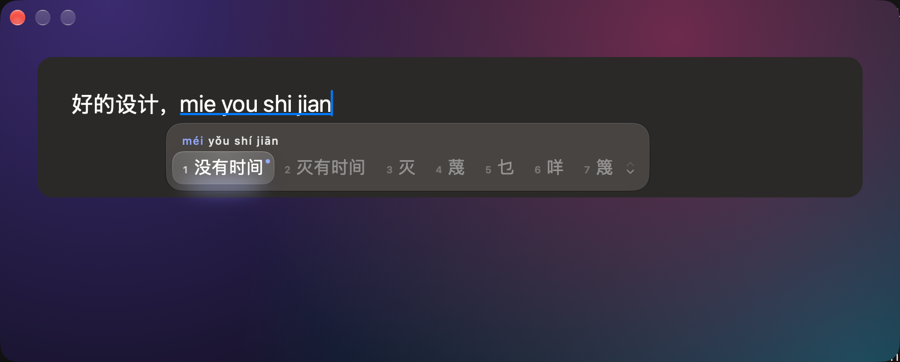

<div align="center">



# Luma 拼音

**一个安静、精致的 macOS 拼音输入法**
**A quiet, refined pinyin input method for macOS**

[中文](#中文) · [English](#english)



</div>

---

## 中文

Luma 基于 [librime](https://github.com/rime/librime) 引擎与 [雾凇拼音 rime-ice](https://github.com/iDvel/rime-ice) 词库，界面用 SwiftUI 重新设计：候选栏上方显示带声调的拼音，选中项平滑滑动，翻页、出现与消失都有细致的动效，并完整适配深色与浅色模式。

### 三套主题

| | 深色 | 浅色 |
|---|---|---|
| **墨 Ink**：宋体、暖纸色，朱红校对线标记选中词 |  |  |
| **光 Lumen**：Liquid Glass 玻璃材质，选中项像一枚透镜 |  |  |
| **刻 Precision**：等宽字体、键帽序号、位置计数，工具感 |  |  |

切换主题：切换到 Luma 后，点击菜单栏的输入法图标 → 「主题」。

### 系统要求

- macOS 14 Sonoma 或更新版本（Liquid Glass 效果需要 macOS 26）
- Apple 芯片或 Intel Mac 均可

### 安装

**方法一：一行命令（推荐）**

打开「终端」，粘贴并回车：

```bash
curl -fsSL https://raw.githubusercontent.com/fancyecho/LumsIME/main/scripts/get.sh | zsh
```

**方法二：手动下载**

1. 在 [Releases](https://github.com/fancyecho/LumsIME/releases/latest) 下载 `LumaIME.zip` 并解压。
2. 把 `LumaIME.app` 移到 `~/Library/Input Methods/`（在访达中按 ⇧⌘G 输入该路径）。
3. 由于应用未经 Apple 公证，需要在终端执行一次：
   ```bash
   xattr -dr com.apple.quarantine ~/Library/Input\ Methods/LumaIME.app
   ```
4. 注销并重新登录（或重启）。

**启用输入法**

系统设置 → 键盘 → 文本输入 → 编辑… → 左下角 ＋ → 简体中文 → **Luma 拼音** → 添加。

> 手动安装后首次使用需要约半分钟编译词库，期间暂时没有候选。如果切换到 Luma 后完全没有反应，请注销再登录一次。

### 使用

| 按键 | 作用 |
|---|---|
| 空格 / 1–7 | 上屏候选 |
| ← → | 移动选中项 |
| `-` `=` 或 ⇞ ⇟ | 翻页 |
| Shift | 中 / 英切换（正在输入的拼音会直接上屏为英文） |
| Esc | 取消输入 |
| 鼠标点击 | 选择候选 |

菜单栏输入法菜单还提供：**智能纠错**开关、**重新部署**（修改配置后生效）、**打开配置目录**、**项目主页**、**检查更新**。

### 自定义

配置与用户词库在 `~/Library/Luma/`。例如修改 `default.custom.yaml` 调整每页候选数：

```yaml
patch:
  schema_list:
    - schema: rime_ice
  menu/page_size: 7
```

保存后在菜单中选择「重新部署」。更多选项可参考 [雾凇拼音文档](https://dvel.me/posts/rime-ice/) 与 [Rime 定制指南](https://github.com/rime/home/wiki/CustomizationGuide)。

### 智能纠错

打字快时常见的手误，Luma 会认出你真正想打的词：

| 手误类型 | 例子 |
|---|---|
| 字母颠倒 | `mieyou` → 没有，`zemneban` → 怎么办 |
| 相邻键误触 | `zhidap` → 知道，`huanyimg` → 欢迎 |
| 重复按键 | `shuurfa` → 输入法，`keyii` → 可以 |
| 漏打字母 | `zhonguo` → 中国，`gonzuo` → 工作 |
| 平翘舌 | `wozidaole` → 我知道了 |
| 前后鼻音 | `minbai` → 明白，`dendai` → 等待 |

整句也一样：`womieyoushijian` → 我没有时间，`jintiantianqizhenhoa` → 今天天气真好。



纠错后的候选右上角有一个小圆点，上方拼音中被纠正的音节会以强调色显示。

它不会打扰正常输入：**如果你打出的拼音本身就是一个词，这个词永远排第一**（比如 `nihai` 仍是「你还」）；纠错只在你打的拼音拼不出像样的词时才上前，否则排在后面供你选择。

实测（`scripts/eval_typo.sh`）：在 1,914 个拼写正确的单字和词语上，开启纠错后首选 0 变化（300 个双词短语中 1 个）；在 720 个随机手误上，颠倒 91%、重复 78%、相邻键 66% 直接排第一，各类手误 82–100% 出现在前三页。漏字母和前后鼻音的手误常常本身就是另一个词（如 `zhanli` 是「站立」），这时会尊重你打出的词。

可以在输入法菜单中随时关闭「智能纠错」，立即生效。

### 更新

Luma 每天会在后台检查一次 [GitHub Releases](https://github.com/fancyecho/LumsIME/releases)，发现新版本时弹出一个小窗口，不会打断输入。也可以随时在输入法菜单中选择「检查更新…」，或关闭「自动检查更新」。

更新时会下载新版本、核对 SHA-256、替换应用并重新编译词库，你的配置与个人词库不受影响。新版本会在你下次打字时启动。

> 0.1.0 没有内置更新器，请用上面的一行命令重新安装一次，之后就能自动更新了。

### 卸载

```bash
curl -fsSL https://raw.githubusercontent.com/fancyecho/LumsIME/main/scripts/uninstall.sh | zsh
```

然后在「系统设置 → 键盘 → 文本输入」中移除 Luma 拼音。个人词库会保留在 `~/Library/Luma`；把命令末尾的 `zsh` 换成 `zsh -s -- --purge` 可一并删除。

### 从源码构建

只需要 Xcode Command Line Tools（`xcode-select --install`）：

```bash
git clone https://github.com/fancyecho/LumsIME.git && cd LumsIME
./scripts/build.sh      # 构建 build/LumaIME.app（Universal）
./scripts/install.sh    # 安装到 ~/Library/Input Methods 并编译词库
```

不安装也能预览界面：

```bash
build/LumaIME.app/Contents/MacOS/LumaIME --playground --theme ink   # 可直接打字的窗口
build/LumaIME.app/Contents/MacOS/LumaIME --demo                      # 自动演示
```

---

## English

Luma is built on the [librime](https://github.com/rime/librime) engine with the [rime-ice](https://github.com/iDvel/rime-ice) dictionaries, wrapped in a SwiftUI interface designed from scratch: tone-marked pinyin above the candidates, a selection that glides between words, considered motion for paging and appearing, and careful dark and light variants.

### Three themes

| | Dark | Light |
|---|---|---|
| **墨 Ink**: Songti type on warm paper, a vermilion proofreader's rule under the chosen word |  |  |
| **光 Lumen**: Liquid Glass, with the selection as a lens of light |  |  |
| **刻 Precision**: monospaced, keycap labels and a position counter, tool-like |  |  |

To switch themes, select Luma, then open the input menu in the menu bar → 主题 (Theme).

### Requirements

- macOS 14 Sonoma or later (Liquid Glass needs macOS 26)
- Apple silicon or Intel

### Install

**Option 1: one command (recommended)**

Open Terminal and run:

```bash
curl -fsSL https://raw.githubusercontent.com/fancyecho/LumsIME/main/scripts/get.sh | zsh
```

**Option 2: manual download**

1. Download `LumaIME.zip` from [Releases](https://github.com/fancyecho/LumsIME/releases/latest) and unzip it.
2. Move `LumaIME.app` into `~/Library/Input Methods/` (in Finder, press ⇧⌘G and paste the path).
3. The app isn't notarized by Apple, so run this once in Terminal:
   ```bash
   xattr -dr com.apple.quarantine ~/Library/Input\ Methods/LumaIME.app
   ```
4. Log out and back in (or restart).

**Turn it on**

System Settings → Keyboard → Text Input → Edit… → ＋ (bottom left) → Chinese, Simplified → **Luma 拼音** → Add.

> After a manual install, the first use spends about half a minute compiling dictionaries, so candidates may not appear right away. If switching to Luma does nothing at all, log out and back in once.

### Usage

| Key | Action |
|---|---|
| Space / 1–7 | Commit a candidate |
| ← → | Move the selection |
| `-` `=` or Page Up / Down | Change page |
| Shift | Toggle Chinese / English (pending pinyin is committed as typed) |
| Esc | Cancel |
| Click | Pick a candidate |

The input menu also has **智能纠错 Typo Correction**, **重新部署 Redeploy** (apply config changes), **打开配置目录 Open Config Folder**, **项目主页 Homepage** and **检查更新 Check for Updates**.

### Customize

Config and your learned words live in `~/Library/Luma/`. For example, edit `default.custom.yaml` to change the page size:

```yaml
patch:
  schema_list:
    - schema: rime_ice
  menu/page_size: 7
```

Then choose Redeploy from the menu. See the [rime-ice docs](https://dvel.me/posts/rime-ice/) and the [Rime customization guide](https://github.com/rime/home/wiki/CustomizationGuide) for more.

### Typo correction

Luma recognises what you meant through the slips of fast typing:

| Slip | Example |
|---|---|
| Swapped letters | `mieyou` → 没有, `zemneban` → 怎么办 |
| Neighbouring key | `zhidap` → 知道, `huanyimg` → 欢迎 |
| Doubled key | `shuurfa` → 输入法, `keyii` → 可以 |
| Dropped letter | `zhonguo` → 中国, `gonzuo` → 工作 |
| z / zh, c / ch, s / sh | `wozidaole` → 我知道了 |
| -n / -ng | `minbai` → 明白, `dendai` → 等待 |

Whole sentences too: `womieyoushijian` → 我没有时间, `jintiantianqizhenhoa` → 今天天气真好.

A corrected candidate carries a small dot, and the corrected syllables in the pinyin line above take the accent colour.

It stays out of the way: **if what you typed already spells a word, that word always comes first** (`nihai` is still 你还). A correction only leads when your syllables don't make a plausible word; otherwise it waits further down.

Measured with `scripts/eval_typo.sh`: on 1,914 correctly typed syllables and words, turning correction on changed the first candidate for none (and for 1 of 300 two-word phrases). On 720 random typos, 91% of swapped, 78% of doubled and 66% of neighbouring-key slips are fixed in first place, and every kind lands within the first three pages 82–100% of the time. Dropped letters and -n/-ng slips often spell another real word (`zhanli` is 站立), and then the word you typed is respected.

Turn it off any time with 智能纠错 (Typo Correction) in the input menu; it takes effect immediately.

### Updates

Once a day Luma quietly checks [GitHub Releases](https://github.com/fancyecho/LumsIME/releases). When there's a new version it shows a small window that doesn't interrupt your typing. You can also choose 检查更新… (Check for Updates…) from the input menu at any time, or turn off 自动检查更新 (Check Automatically).

Updating downloads the new build, verifies its SHA-256, swaps the app and recompiles the dictionaries; your config and learned words are untouched. The new version starts the next time you type.

> 0.1.0 has no built-in updater: reinstall once with the one-line command above, and later versions update themselves.

### Uninstall

```bash
curl -fsSL https://raw.githubusercontent.com/fancyecho/LumsIME/main/scripts/uninstall.sh | zsh
```

Then remove Luma 拼音 under System Settings → Keyboard → Text Input. Your words in `~/Library/Luma` are kept; replace the trailing `zsh` with `zsh -s -- --purge` to remove them too.

### Build from source

Only the Xcode Command Line Tools are needed (`xcode-select --install`):

```bash
git clone https://github.com/fancyecho/LumsIME.git && cd LumsIME
./scripts/build.sh      # → build/LumaIME.app (universal)
./scripts/install.sh    # installs to ~/Library/Input Methods and compiles dictionaries
```

Preview the UI without installing:

```bash
build/LumaIME.app/Contents/MacOS/LumaIME --playground --theme ink   # a window you can type into
build/LumaIME.app/Contents/MacOS/LumaIME --demo                      # an automatic demo
```

`scripts/make_icon.swift` draws the app and menu-bar icons; `scripts/package.sh` makes `dist/LumaIME.zip` for a release; `scripts/eval_typo.sh` measures typo correction (recall on generated typos, and what changes for correctly typed input).

| Path | Purpose |
|---|---|
| `Sources/Rime.swift` | librime C API wrapper, data directories |
| `Sources/InputEngine.swift` | Per-session logic: keys → commit / marked text / candidates |
| `Sources/InputController.swift` | `IMKInputController` bridge and input menu |
| `Sources/CandidatePanel.swift` | Floating panel, the three themes and their motion |
| `Sources/Settings.swift` | Settings, tone-marked pinyin header, syllable splitting |
| `Sources/Updater.swift` | GitHub Releases update check and in-place install |
| `Support/rime/lua/luma_typo.lua` | Decides where typo corrections go among the candidates |
| `scripts/make_typo_schema.py` | Generates the typo-spelling prism and the patch that wires it in |
| `Sources/Playground.swift` | Standalone preview window |
| `design/` | HTML design comps |

---

## License · 许可

Luma is released under the [GNU GPL v3](LICENSE), matching the bundled rime-ice dictionaries.
Bundled components: [librime](https://github.com/rime/librime), [librime-lua](https://github.com/hchunhui/librime-lua), [librime-octagram](https://github.com/lotem/librime-octagram), [librime-predict](https://github.com/rime/librime-predict) (BSD-3-Clause, see `vendor/librime/licenses/`), and [rime-ice](https://github.com/iDvel/rime-ice) (GPL-3.0).

本项目以 GPL v3 发布。感谢 Rime 与雾凇拼音的作者们。
